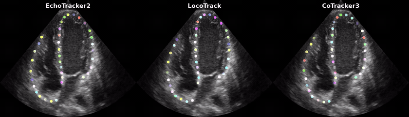

# 🎯 Point Tracking in Echocardiography 🫀

<p align="center">
  
</p>

If you find this work useful, please consider giving the repository a ⭐ — it helps others discover the project and motivates further development!

---
> **This repo contains the official implementations for the following papers:**

## 📄 Papers
| # | Title | Venue | Links |
|---|-------|-------|-------|
| 1 | <h4>EchoTracker2: Enhancing Myocardial Point Tracking by Modeling Local Motion</h4> | **MICCAI 2026 (top 9%)** | <a href="#"></a> <a href="#paper-1"></a> <a href="#"></a> |
| 2 | <h4>Taming Modern Point Tracking for Speckle Tracking Echocardiography via Impartial Motion</h4> | **CVAMD @ ICCV 2025** | <a href="https://openaccess.thecvf.com/content/ICCV2025W/CVAMD/html/Azad_Taming_Modern_Point_Tracking_for_Speckle_Tracking_Echocardiography_via_Impartial_ICCVW_2025_paper.html"></a> <a href="https://arxiv.org/abs/2507.10127"></a> <a href="#"></a> |

---

## 🔧 Installation
 
### Requirements
 
- Python >= 3.10 
- A CUDA-capable GPU with CUDA >= 11.7 — **required, not optional**: every model wrapper in `models/net.py` hardcodes its device to `cuda:<id>` with no CPU fallback, so none of the demos will run on a CPU-only machine
- PyTorch >= 2.0
- ffmpeg (system binary — required by `mediapy` for reading/writing videos; install via your OS package manager, e.g. `apt install ffmpeg`)
 
### Setup
 
Clone the repo and create an isolated environment before installing dependencies — either conda or a plain `venv` works.
 
```bash
git clone https://github.com/riponazad/ptecho.git
cd ptecho

# Option A: conda
conda create -n ptecho python=3.10 -y
conda activate ptecho

# Option B: venv (skip this if you created a conda env above)
python3 -m venv .venv
source .venv/bin/activate   # Windows: .venv\Scripts\activate

pip install -r requirements.txt
```
 
---
 
## 🚀 Usage

### Model weights

Download each checkpoint and place it in the corresponding destination folder before running any demo.

| Model | Checkpoint | Destination |
|---|---|---|
| EchoTracker2 | [`model-0.pth`](https://drive.google.com/file/d/17SiOG8MUpCxK1_MZ-LfIGrH2mDDv329l/view?usp=sharing) | `weights/echotracker2/` |
| LocoTrack | [`model-85.pth`](https://drive.google.com/file/d/1AHYr-yHkXEku90j_2q-qNCkPYa5OnEjq/view?usp=sharing) | `weights/locotrack/` |
| CoTracker3 | [`model-0.pth`](https://drive.google.com/file/d/15ofxRu1H--nsxU6HiLqsY6lZaxgKN5uQ/view?usp=sharing) | `weights/cotracker3/` |
| EchoTracker | [`model-0.pth`](https://drive.google.com/file/d/1e1jt2j4rTHtdwUBqmqYdMcVHU1und66d/view?usp=sharing) | `weights/echotracker/` |
| PIPs++ | [`model-0.pth`](https://drive.google.com/file/d/1WmLB7s7XCefZqvp4QBqo31uVzTh82OgS/view?usp=sharing) | `weights/pips2/` |
| SpeckNet | [`model-0.pth`](https://drive.google.com/file/d/19QJJYJ8wKqzL_UbH4JGANn4pP1hHKSiH/view?usp=sharing) | `weights/specknet/` |


Update the paths in [configs.py](configs.py) if you store weights elsewhere.

---

### Demo 1 — Interactive tracking on a video <a name="paper-1"></a>

A single-window interactive app: play an echocardiography video, pick a query frame, click tracking points, choose one or more models, and watch the results play back side by side — each with an approximate GLS (global longitudinal strain) curve. The comparison video is also saved to `outputs/output.mp4`.

```bash
# Run with the default video (data/input1.mp4)
python demo1.py

# Run with a custom video
python demo1.py --video_path data/input2.mp4

# Choose which models are checked by default when the window opens
python demo1.py --default_models='("EchoTracker2", "PIPs++")'
```

**Controls:**

| Control | What it does |
|---|---|
| **Frame slider** | Jump to any frame — pauses playback and freezes that frame for point selection. |
| **Pause & Select Points** | Freezes on the currently playing frame instead of using the slider. |
| Click on the frame | Places a query point (up to 40). For a meaningful GLS curve, click points *in order* along the myocardial wall (e.g. apex → base). |
| **Clear Points** | Removes all points on the current frame. |
| **Models to run** | Check any subset of the 6 models to compare side by side. |
| **Compute GLS** | On by default; uncheck to skip strain computation and get tracking-only output. |
| **Run Tracking** | Runs the checked models on the selected points and shows the results grid. |

Available models: `EchoTracker2`, `LocoTrack`, `CoTracker3`, `EchoTracker`, `PIPs++`, `SpeckNet`

> GLS here is a simple 2D approximation — percent change in the length of the polyline connecting your query points, relative to the video's first frame — not a substitute for vendor speckle-tracking GLS. It's only meaningful if points are clicked in anatomical order along the wall.

Changing the model or GLS selection after results are shown resets the window back to the playing view, ready for a new selection.

---

### Demo 2 — Quantitative evaluation on annotated data <a name="paper-2"></a>

Loads ground-truth annotated data from `data/lv_sample.pkl` by default, runs each model, and overlays per-model metrics (points within 1/2/4 px, median trajectory error) on the output video saved to `outputs/demo2_output.mp4`.

Three sample files ship with the repo — `data/lv_sample.pkl` (left ventricle), `data/rv_sample.pkl` (right ventricle), and `data/camus_sample.pkl` (CAMUS dataset).

```bash
# Run with all models on the default sample (LV)
python demo2.py

# Run with specific models only
python demo2.py --model_names='("EchoTracker2", "EchoTracker")'

# Run on a different annotated pickle file
python demo2.py --data_path data/rv_sample.pkl

# Choose a specific query frame (default: 72% into the sequence)
python demo2.py --q_frame 20
```

`data_path` must point to a pickle file whose `frames`, `trajs`, and `visibility` entries follow the same layout as the shipped sample files (each with a leading batch dimension) — see `demo2.py` for the exact tensor shapes it expects. Note this differs from the `Dataset` format used for training, below. The corner label on the output video defaults to a name derived from `data_path` (e.g. `lv_sample.pkl` → "LV"); override it with `--overlay_label`.

---

## 🏋️ Training / Fine-tuning

> **Note:** The echocardiography datasets used in our papers are not publicly available due to patient privacy restrictions. However, you are welcome to train or fine-tune any model on your own annotated data by following the instructions below.

### Data format

Your PyTorch `Dataset` must return three tensors per sample:

| Tensor | Shape | Description |
|--------|-------|-------------|
| `frames` | `[T, H, W, C]` | Video frames, uint8 or float, values in `[0, 255]` |
| `trajs` | `[T, N, 2]` | Point trajectories, `(x, y)` normalized to `[0.0, 1.0]` |
| `visibs` | `[T, N]` | Visibility mask — `1` if the point is visible, `0` otherwise |

where `T` = number of frames, `N` = number of tracked points.

### Example: training EchoTracker2 from scratch

```python
from torch.utils.data import DataLoader
from models.net import ECHOTRACKER2

# ------------------------------------------------------------------
# 1. Build your dataset — must return (frames, trajs, visibs)
# ------------------------------------------------------------------
class MyEchoDataset(torch.utils.data.Dataset):
    def __init__(self, root, split):
        ...  # load your file list

    def __getitem__(self, idx):
        frames  = ...  # torch.Tensor [T, H, W, C], float, [0, 255]
        trajs   = ...  # torch.Tensor [T, N, 2],    float, [0.0, 1.0]
        visibs  = ...  # torch.Tensor [T, N],        float, {0, 1}
        return frames, trajs, visibs

train_set = MyEchoDataset(root="data/custom", split="train")
val_set   = MyEchoDataset(root="data/custom", split="val")

dataloaders  = {
    "train": DataLoader(train_set, batch_size=1, shuffle=True,  num_workers=4),
    "val":   DataLoader(val_set,   batch_size=1, shuffle=False, num_workers=4),
}
dataset_size = {"train": len(train_set), "val": len(val_set)}

# ------------------------------------------------------------------
# 2. Instantiate and train
# ------------------------------------------------------------------
model = ECHOTRACKER2(device_ids=[0], sp_attn=True,
                    resnet_temp_module=True, patch_size=9)

model.train(
    dataloaders=dataloaders,
    dataset_size=dataset_size,
    log_dir="outputs/logs/echotracker2",
    ckpt_path="weights/echotracker2_custom",
    epochs=50,
    accumulation_steps=4,
    q_frame=0,   # 0 = track forward from first frame
                 # -1 = use 75% frame, -2 = random frame each batch
)
```

本地 EchoTracker2 训练入口使用单 GPU、单视频 micro-batch，避免发布实现把不同视频混入时间和点邻域；通过 `accumulation_steps` 调整有效批量。四次细化结果共同参与损失。检查点保存为 `ckpt_path/best.pth`、`ckpt_path/latest.pth`，原生训练和验证指标保存到 `log_dir/history.jsonl`。最佳模型按验证集 L1 `<δavg(1,2,4)` 选择，平局取 MTE 更低者。

### Fine-tuning from pretrained weights

设置发布模型的结构参数，并在训练前调用 `load(..., eval=False)`。加载仅允许已核实的四个发布权重额外投影键，其余键和尺寸严格匹配：

```python
model = ECHOTRACKER2(device_ids=[0], ft_model=True, sp_attn=True,
                    resnet_temp_module=True, patch_size=9)
model.load(path="weights/echotracker2/model-0.pth", eval=False)

model.train(
    dataloaders=dataloaders,
    dataset_size=dataset_size,
    log_dir="outputs/logs/echotracker2_ft",
    ckpt_path="weights/echotracker2_ft",
    epochs=20,
    accumulation_steps=4,
    lr=5e-5,
)
```

## EchoXFlow A4C 后训练

本轮实验的数据处理、划分、论文评估口径和完整结果见 [实验结果讲解报告](outputs/echoxflow_a4c/RESULTS_zh.md)。

工作目录：`/root/ultrasound/EchoTracker2`。配置入口为 `echoxflow_a4c.json`，物理 GPU 1 通过 UUID 绑定，进程内映射为 `cuda:0`。准备阶段复用 `../m2p/.venv-data` 的 Python 3.13 与固定版本官方扫描转换源码；训练和评测使用本目录 `.venv` 的 Python 3.11 / PyTorch 2.5.1。

```bash
# 从共享原始库核验、扫描转换并准备 A4C 缓存。
../m2p/.venv-data/bin/python -B echoxflow.py prepare

# 原始权重和静止点基线。
.venv/bin/python -B echoxflow.py evaluate --model pretrained static

# 单种子 20 轮后训练；验证集选择最佳权重。
.venv/bin/python -B echoxflow.py train

# 在固定测试集评测最佳后训练权重。
.venv/bin/python -B echoxflow.py evaluate --model finetuned

# 从最近完成的一轮继续，配置和源码必须一致。
.venv/bin/python -B echoxflow.py train --resume outputs/echoxflow_a4c/checkpoints/latest.pth
```

数据固定为 `Ahus-AIM/EchoXFlow@d907c536cae16750b9e46f269a27befd4979ebdd`，从 `../data/echoxflow/raw` 读取。按官方关联和视频内容哈希去重，重复标注按标注记录 ID、视频记录 ID 排序选择。291 段明确配对的 A4C 按官方 0–2/3/4 折分为 163/64/64 段训练、验证、测试视频；77 条未解析的多平面链接排除，历史 ED/ES 筛选不参与本实验。

图像与米制轮廓使用同一正方形物理视野，转换至 256×256，像素中心范围为 0–255。轮廓取中层 `2::5` 并保留沿壁顺序。时间匹配容差为半个视频帧间隔加 1 微秒，冲突取误差最小者；未匹配帧、非有限坐标和扇区外参考点由掩码排除，不插值补标签。准备缓存保存源数组哈希、几何和帧关联，配置不匹配须重新准备。

训练使用随机连续片段 `min(36,T)`、最多40个有效查询点、随机查询帧、各0.5概率的水平翻转和时间反转。全参数 FP32、micro-batch=1、累积4次梯度、种子20261013；AdamW 峰值学习率 `5e-5`、weight decay `1e-6`、OneCycleLR 按实际优化器更新次数调度，四次 masked L1 损失权重为 `0.8^(3-i)/4`。每轮验证，以 L1 三阈值均值最高者保存最佳权重，平局时取 L1 MTE 更低者；测试集不参与选择。本轮不包含论文的 impartial motion 增强。

论文中的 iTSM 对应 `ResNet_echo2/ExtraConvs_echo2`；9×9 三尺度 4D 相关对应 `joint_refine/CMDTop`；`KNPTransformer` 在发布代码中按点索引邻域进行空间注意力，并非显式几何 kNN。模型可通过 `return_iterations=True` 返回 `iterations[4,B,N,T,2]`，默认最终 `tracks[B,N,T,2]` 接口保持兼容。

评测从首个匹配帧的有效中层点查询，追踪整个标注覆盖区间，排除查询帧和无效参考位置。主指标使用 L1 距离、严格小于1/2/4像素的百分比及其均值；MTE 为每点时间误差中位数的点均值，再对视频等权平均。辅助 L2 指标明确区分三阈值和五阈值均值。指标均描述与软件参考轨迹的一致性，不提供独立组织点真值或临床 GLS 精度证明。

派生数据、指标、测试预测和检查点集中在 `outputs/echoxflow_a4c/`：

- `prepared/manifest.json` 和 `prepared/sequences/`：数据来源、固定划分、像素轨迹和有效掩码。
- `config.json`、`runtime_*.json`、`source/`、`commands.log`：实际配置、代码与权重哈希、源码、环境和命令。
- `training/history.jsonl`、`checkpoints/best.pth`、`checkpoints/latest.pth`：每轮指标及模型、优化器、调度器和随机状态。
- `evaluation/test/{pretrained,finetuned,static}/`：原生指标、逐视频 CSV 和预测坐标。
- `evaluation/test/paired_bootstrap.json`：配对差值、按检查分组的置信区间、改善与退化视频数及统计输入哈希。

已知风险的回归检查：`.venv/bin/python -B -m unittest discover -s tests -v`。配对统计按检查 ID 分组，对相同测试视频的后训练与原始权重指标之差进行2000次 bootstrap 重采样，使用种子20261013及百分位95%置信区间；每次抽取检查后纳入其全部视频，继续按视频等权计算。统计在实验分析时直接计算，不另设固定报告生成入口。

---
 
## 📝 Citation
 
If you find our work useful, please consider citing **both** of the papers this repo implements:
 
```bibtex
@article{azad2026echotracker2,
  title={EchoTracker2: Enhancing Myocardial Point Tracking by Modeling Local Motion},
  author={Azad, Md Abulkalam and Holmstr{\o}m, Vegard and Nyberg, John and Lovstakken, Lasse and Dalen, H{\aa}vard and Grenne, Bj{\o}rnar and {\O}stvik, Andreas},
  journal={arXiv preprint arXiv:2605.12140},
  year={2026}
}
 
@InProceedings{Azad_2025_ICCV,
    author    = {Azad, Md Abulkalam and Nyberg, John and Dalen, Havard and Grenne, Bj{\o}rnar and Lovstakken, Lasse and {\O}stvik, Andreas},
    title     = {Taming Modern Point Tracking for Speckle Tracking Echocardiography via Impartial Motion},
    booktitle = {Proceedings of the IEEE/CVF International Conference on Computer Vision (ICCV) Workshops},
    month     = {October},
    year      = {2025},
    pages     = {1115-1124}
} 
```

### Citing individual models

This repo also bundles several point-tracking models as baselines. If your work specifically uses one of them, please **additionally** cite its original paper:

| Model | Original paper |
|---|---|
| `EchoTracker2`, `SpeckNet` | Already covered by the two papers above |
| `EchoTracker` | Azad et al., *EchoTracker: Advancing Myocardial Point Tracking in Echocardiography*, MICCAI 2024 — [repo](https://github.com/riponazad/echotracker) |
| `LocoTrack` | Cho et al., *Local All-Pair Correspondence for Point Tracking*, ECCV 2024 — [repo](https://github.com/cvlab-kaist/locotrack) |
| `CoTracker3` | Karaev et al., *CoTracker3: Simpler and Better Point Tracking by Pseudo-Labelling Real Videos*, ICCV 2025 — [repo](https://github.com/facebookresearch/co-tracker) |
| `PIPs++` | Zheng et al., *PointOdyssey: A Large-Scale Synthetic Dataset for Long-Term Point Tracking*, ICCV 2023 — [repo](https://github.com/aharley/pips2) |
 
---
 
## 📜 License

This project uses a multi-license structure due to third-party code inclusion.

| Component | License |
|---|---|
| Original code (EchoTracker, EchoTracker2, SpeckNet, demos, utils) and all model weights/checkpoints released from this repository | [CC BY-NC 4.0](LICENSE) |
| CoTracker3 integration code (`models/cotracker3.py`, `models/cotracker/`) — [source](https://github.com/facebookresearch/co-tracker) | [CC BY-NC 4.0](https://github.com/facebookresearch/co-tracker/blob/main/LICENSE.md) |
| LocoTrack integration code (`models/locotrack.py`) — [source](https://github.com/cvlab-kaist/locotrack) | Apache License 2.0 |
| PIPs++ integration code (`models/pips2.py`) — [source](https://github.com/aharley/pips2) | MIT License |

This project's original code and model weights are free to use for **noncommercial purposes only** (e.g., academic research, education, personal projects), with attribution. This covers all checkpoints released from this repository, including the fine-tuned LocoTrack, CoTracker3 and PIPs++ checkpoints produced by this project — see [Model weights](#model-weights). **Commercial use is not permitted under this license.** If you wish to use this project's code or weights for commercial purposes, you must obtain a separate commercial license agreement. Commercial licensing is handled by NTNU Technology Transfer AS (NTNU TTO) — you can reach out to them directly, or contact md.a.azad@ntnu.no or andreas.ostvik@ntnu.no, who will coordinate with NTNU TTO.

If you use other, third-party pretrained models alongside this project (e.g., a base LocoTrack, CoTracker3 or PIPs++ checkpoint from its original source), check that model's own license terms separately — they are not covered by this project's license.

When using this project, retain the respective license notices for each component. See the [`LICENSE`](LICENSE) file for full terms.
